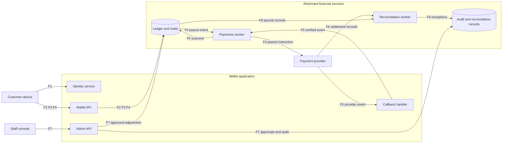

# Wallet architecture and data flows

| Flow | Source and destination | Boundary and data | Authoritative record |
| --- | --- | --- | --- |
| F1 Account access and recovery | Customer device to identity service | Public client to wallet application. Credentials, recovery proofs, and sessions. | Identity and session records |
| F2 Deposit | Customer device to wallet API to ledger workflow. Provider confirmation arrives via F5. | Public client to wallet application to restricted services. Deposit intent, amount, and provider reference. | Ledger journal for wallet credit and provider evidence for receipt |
| F3 Internal transfer | Customer device to wallet API to ledger | Public client to wallet application to restricted services. Sender, recipient, amount, and operation ID. | Ledger journal |
| F4 Withdrawal | Customer device to wallet API to ledger to payments worker to provider | Public client to wallet application to restricted services to external provider. Approved payout details, hold, and operation ID. | Ledger for held and posted funds. Provider for payout outcome. |
| F5 Callback | Provider to callback handler to payments worker and ledger | External provider to wallet application to restricted services. Authenticated event, provider reference, amount, currency, and status. | Verified event record and guarded transaction state |
| F6 Reconciliation | Provider and ledger to reconciliation worker and exception store | External provider to restricted services. Settlement records, journal entries, and discrepancies. | Provider settlement records and ledger journal for their respective balances. Exception record for disposition. |
| F7 Staff adjustment | Staff console to admin API to ledger and audit store | Staff client to wallet application to restricted services. Actor, approver, reason, and journal reference. | Ledger adjustment journal and approval audit record |

## Financial state and failure handling

- **Withdrawals.** Authorize the exact amount, currency, and destination. Atomically write the hold and a durable payout intent. Submit to the provider using a stable payout identifier. A verified success consumes the hold and posts the withdrawal once. A confirmed terminal failure releases the hold once. On timeout or ambiguous outcome, keep the hold and resolve the payout using provider evidence before deciding whether to resubmit or release it.
- **Deposits and transfers.** Credit deposits only after verified provider evidence satisfies the configured funding policy. Post each internal transfer as one balanced journal using an atomic available-funds check. A repeated operation returns the existing result. Reuse of an operation ID with different details is rejected.
- **Callbacks and reversals.** Record authenticated events durably and deduplicate processing. Match outcomes to the expected transaction and validate state transitions. Post authorized reversals as linked compensating entries. Route conflicting outcomes or reversals that cannot be applied to an exception workflow.
- **Reconciliation.** Compare provider settlement records with ledger postings, including missing records and amount or currency mismatches. Track each discrepancy to resolution. Corrections that change balances follow F7.
